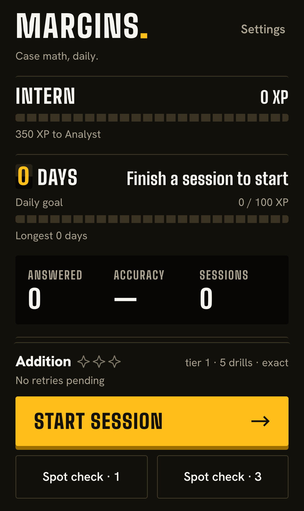
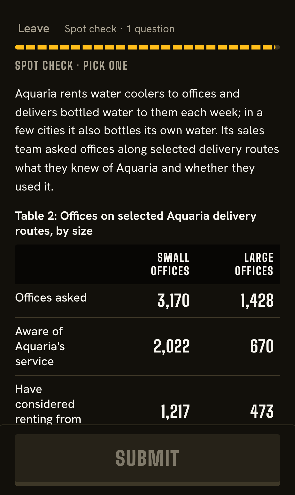
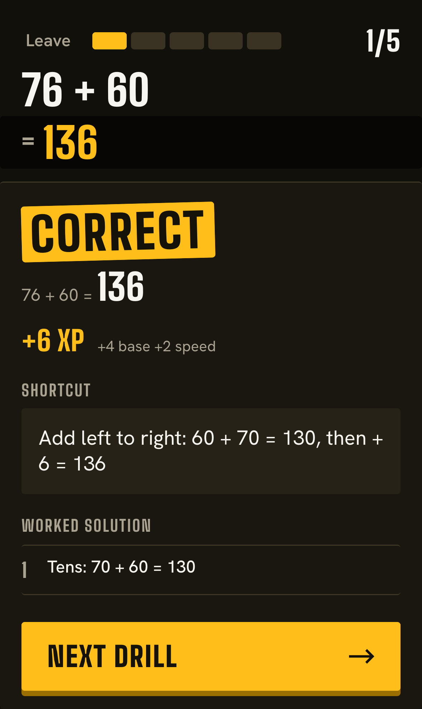

# Margins

A phone app for practising business mental math, a few minutes a day. I'm a product manager and I like building things that feed my own curiosity. This one I vibecoded in three days with Claude Code.

<p>
  
  
  
  
</p>

## Why mental math, now

I think being quick with numbers matters more as AI gets better, not less.

- **You can't check what you can't estimate.** A model hands you a number in a second. Number sense is how you notice it is wrong by a factor of ten.
- **Thinking happens in the room.** A conversation about pricing or a forecast does not pause while someone opens a tool. If you can do the arithmetic, you stay in the argument.
- **Use it or lose it.** The skill is now easy to outsource, so it fades unless you practise it on purpose.

The hardest business arithmetic I know of sits in the screening tests the big consulting firms (McKinsey, BCG, Bain) use: a paragraph, a table or a chart, four close options, about two minutes. I wanted that kind of practice on my phone, in the spare minutes I actually have, and I wanted it not to run out.

## What it does

- **Drills.** Bare arithmetic in ten skills, typed on a large keypad. Easy ones are marked exactly, hard ones within about 3%, so a sound estimate counts.
- **Scenario and chart questions.** Multiple choice, with tables and drawn charts (bar, stacked, line, pie, cumulative, waterfall), in nine skills such as break-even, unit economics and testing statements against data.
- **Every miss teaches.** After each answer you see the worked solution and the fastest shortcut.
- **Retries.** A missed question comes back in the next session, then once more about three days later.
- **Sprints, spot checks and timed mocks**, and a trends view to show whether you are getting faster.
- **A light game layer.** Streak, daily goal, XP, mastery per skill, badges.

It is an installable web app that works offline. There are no accounts and no backend; progress stays on the phone.

## Where the questions come from

This is the part I most wanted to get right. A stack of practice tests runs out after one pass, so the app needed new questions that train the same thing as the real ones. It has three sources.

| Source | How many | What it is |
|---|---|---|
| Generated | 49 templates | Code that draws new numbers every time, so a question never repeats exactly. |
| Authored, original | 162 questions | One-off scenarios written for the app. |
| Authored, modelled on a test question | 533 questions from 86 sources | Each keeps the structure, difficulty and traps of one practice-test question and changes everything a reader would recognise: company, industry, wording and every number. |

The practice-test questions I started from (103 of them, from McKinsey PST and BCG Potential Test practice material) are **not in this repository**. They belong to their publishers. The app's code can still load them from a local folder, which is how my own copy works; without them the app runs on the other three sources.

### How a new question earns its place

Writing 500 plausible-looking questions with a language model is easy. Knowing they are correct, unambiguous and as hard as the original is the real work, so most of the effort went into the checks. The standard is **parity with the source: a new question fails only where it is worse than the question it is modelled on.**

A candidate is admitted to the bank only when all of these pass:

1. **Its own calculation.** Every question carries a formula that recomputes the answer from numbers the reader can see. A test runs it.
2. **Its traps.** The slips behind the wrong options (wrong base, skipped step, factor of ten) are declared as formulas too, and a test confirms each one lands on its wrong option and never on the right one.
3. **A blind solve.** A fresh model that has seen only the question text, never the answer, must pick the same option. The result is recorded against a fingerprint of the text, so editing a question voids its check.
4. **Originality.** No company or case name from a source test, no eight-word run of source wording, and at most two distinctive figures in common.
5. **Fidelity and variety.** Same skill, tier, exhibit type and length as its source, within set bands, and not a renamed copy of a sibling.
6. **Four judges.** Separate model judges for ambiguity, distractor quality, realism and difficulty. Each judge was first calibrated on questions with known answers, including deliberately broken copies, and was trusted only if it passed at least 90% of the good ones and failed at least 80% of the broken ones.

The roles were kept apart: one model wrote, a different one solved blind, fresh ones judged, and none of them checked its own work.

Over three rounds, 548 candidates were written and 533 admitted. In the first round, fourteen candidates let a common mistake land on the correct answer, so someone making the mistake would have been marked right. That is why traps became a check of their own. The full method is in [`evals/README.md`](evals/README.md), the writer's brief in [`evals/WRITING.md`](evals/WRITING.md), the judge prompts in [`evals/judges/`](evals/judges), and what each round found in [`evals/rounds/`](evals/rounds).

### One example

A source question gave a table of product counts and profits by category, and asked for profit per product after a rise in profits. Its wrong options came from two slips: getting the direction of the change wrong, and losing a factor of ten when turning millions into units. Eight variants were written from that pattern. This is one of them:

> SportsHub, an online seller of sports equipment, is measuring its performance against four larger competitors with wider ranges.
>
> | Company A | Bikes | Footwear | Clothing |
> |---|---|---|---|
> | Number of products | 12 | 64 | 39 |
> | Profits ($ millions) | 14 | 6 | 10 |
>
> Company A plans to grow profits by 20% in 2013 in each of its categories, with no change in the number of products it sells. What would its total profits per product be in 2013?
>
> A. $31,304  B. $313,043  C. $20,870  D. $208,696

What the bank stores beside it:

```json
"check": { "kind": "value", "answer": "(14 + 6 + 10) * (1 + 20 / 100) * 1000000 / (12 + 64 + 39)" },
"traps": [
  { "slip": "slips a factor of ten when turning millions into units", "option": "$31,304" },
  { "slip": "cuts profits by 20% instead of raising them", "option": "$208,696" },
  { "slip": "cuts profits by 20% and slips a factor of ten", "option": "$20,870" }
],
"shortcut": "36 ÷ 115 is just over 0.3, so about $310,000 a product; count the digits to rule out its ten-times partner."
```

### What I would not claim

- I did not read every question. The last round's 217 variants passed every automated check and went in unread, on my call. The reasoning and what it gives up are written down in `evals/README.md`.
- The checks cannot be re-run from this repository, because they compare each candidate with its source and the sources are not published. The calibration inputs are left out for the same reason. The code, the prompts, every recorded verdict and the round records are here.
- Model judges disagree with each other on close calls. The round records say where.

## How it was built

Three days, 24 to 26 November 2026, about 230 commits, all through Claude Code. I did not write the code by hand.

What I did:

- **Spec and scope.** The problem, 93 user stories, what is out of scope, and how I would know it works: a mock score of 70% or more and a falling average time per drill. See [`docs/spec.md`](docs/spec.md).
- **The quality bar.** The one criterion (parity with the source), which checks block and which only warn, when to change a rule and when to drop a question instead.
- **Design direction.** A match-day scoreboard for an adult: numbers are the hero, one thing to do per screen, no mascots and no confetti. See [`PRODUCT.md`](PRODUCT.md) and [`DESIGN.md`](DESIGN.md).

What Claude did: the code, the tests, the question templates, the question writing, the blind solving and the judging, working from those documents. A shared vocabulary ([`GLOSSARY.md`](GLOSSARY.md)) kept the spec, the code and the prompts using the same words for the same things.

## Run it

```sh
npm install
npm run dev        # the app, at the address Vite prints
npm test           # unit tests; those that need the practice-test questions are skipped
npm run build
```

Built with TypeScript, Preact and Vite. Best viewed at phone width.

## Use and credits

This is a personal, non-commercial project, shared to show how it was made. No licence is granted: you are welcome to read the code, but please do not reuse or redistribute it.

Margins is not affiliated with or endorsed by McKinsey & Company, Boston Consulting Group or Bain & Company. Their names are used only to describe the test formats the questions are modelled on. If you hold rights in any material here and want it changed or removed, open an issue.
