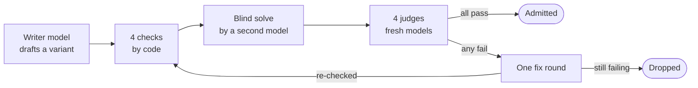
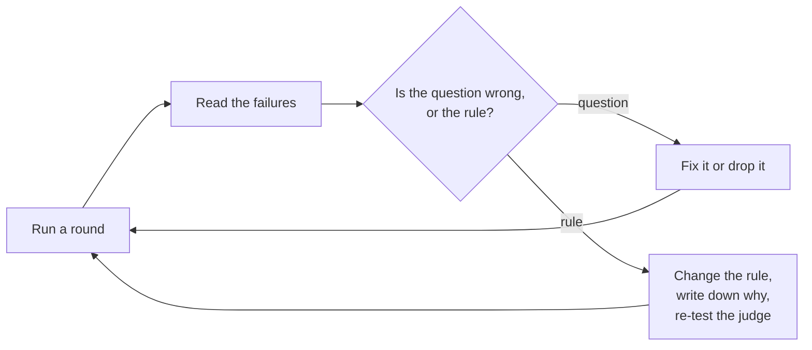
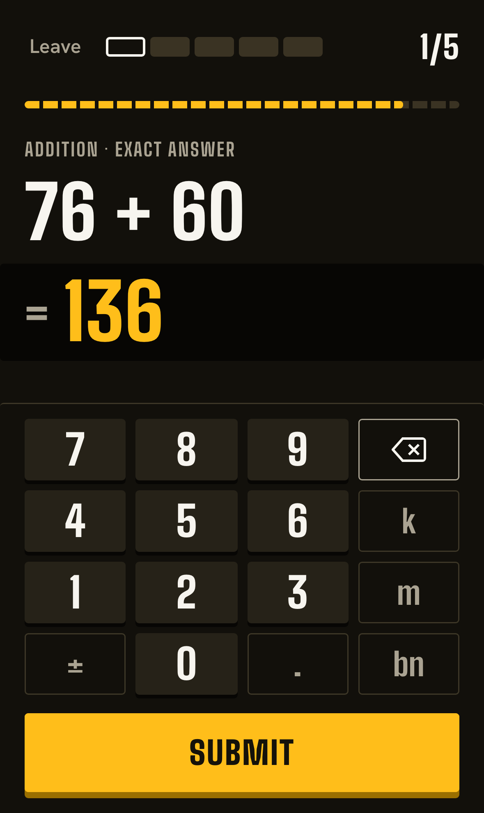
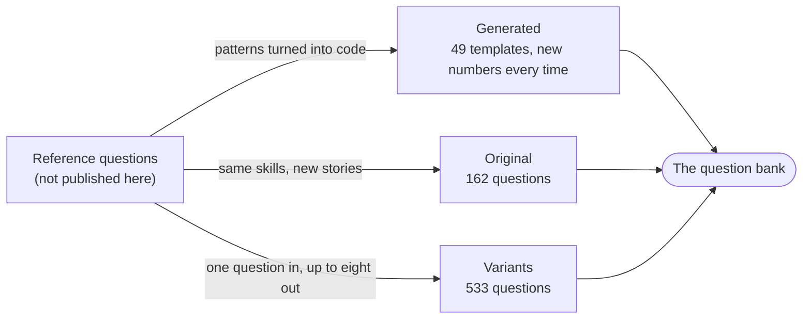

# Margins

**Can a model write practice questions as good as the published ones, and how would I know?**

Margins is a phone app for practising business mental math. I'm a product manager and I vibecoded it in three days with Claude Code. Most of the work went into the evals that decide which AI-written questions are allowed in.

**[Try the app](https://gibranmkyn.github.io/margins-mental-math/)** (best on a phone)

**695 questions · 7 evals · 97% of AI-written questions pass after one fix round · 2,100+ automated tests**

## The problem

Good practice questions are scarce. A set of published practice tests runs out after one pass, and once you have seen a question you are remembering, not calculating.

So I had a model write **variants**: each keeps the structure, difficulty and traps of one reference question and changes everything a reader would recognise, such as the company, the industry, the wording and every number. Getting a model to write 500 plausible questions takes an afternoon. Knowing they are correct, unambiguous and as hard as the original is the real work.

## The evals I built



| Eval | What it asks | Why it exists |
|---|---|---|
| **Calculation** (code) | Does the answer recompute from the numbers shown? | A model states a wrong answer as confidently as a right one. Arithmetic should be proved, not judged. |
| **Traps** (code) | Does each declared slip land on a wrong option, and never on the right one? | If a common mistake lands on the correct answer, the app rewards the wrong method. |
| **Originality** (code) | Are the wording, names and figures new? | A variant has to be a new question, not a paraphrase of its source. |
| **Fidelity and variety** (code) | Is it the same shape as its source, and not a copy of a sibling? | Left alone, a model drifts easier or longer, and repeats its own stories. |
| **Blind solve** (model) | Does a model that sees only the question pick the same answer? | The writer cannot see its own ambiguity. A solver without the answer key can. |
| **Four judges** (model) | Is it unambiguous, are the wrong options good, is it realistic, is it as hard as the source? | These are the qualities code cannot measure. One judge per failure mode keeps each verdict narrow. |
| **Judge calibration** | Does each judge catch known-bad questions and pass known-good ones? | A judge is a model too. It has to earn trust before its verdicts count. |

**One standard for every eval:** a new question fails only where it is worse than the question it is modelled on.

### Results

| | Written | Passed everything first time | After one fix round |
|---|---|---|---|
| The two main rounds | 448 | 379 (85%) | 437 (97%) |

Across the whole project, pilot included, 548 variants were written and 533 are in the bank.

### Design choices

- **Code first, models second.** Anything that can be computed is computed. Models judge only what code cannot.
- **No model marks its own work.** One model writes, a different one solves blind, fresh ones judge.
- **Judges are tested before they are trusted.** Each judge first ran on questions with known verdicts, including deliberately broken copies. It was used only if it passed at least 90% of the good ones and caught at least 80% of the broken ones.
- **Results are tied to the exact text.** Each verdict is stored against a fingerprint of the question, so editing a question voids its results.

The full method is in [`evals/README.md`](evals/README.md), the writer's brief in [`evals/WRITING.md`](evals/WRITING.md), the judge prompts in [`evals/judges/`](evals/judges) and the record of each round in [`evals/rounds/`](evals/rounds).

## One pattern, many questions

One reference question gave a table of product counts and profits by category, and asked for profit per product after a rise in profits. Its wrong options came from two slips: getting the direction of the change wrong, and losing a factor of ten when converting millions. Eight variants were written from that pattern. Three of them:

| Setting | The change | Right answer | Slip 1: wrong direction | Slip 2: factor of ten |
|---|---|---|---|---|
| Garden products retailer | profits up 10% | £390,071 | £319,149 | £3,900,709 |
| Online sports equipment seller | profits up 20% | $313,043 | $208,696 | $31,304 |
| Kitchenware chain | profits up 10% | £417,722 | £341,772 | £4,177,215 |

Each one is stored with the formula that proves its answer and the formulas for its slips:

```json
"check": { "kind": "value", "answer": "(14 + 6 + 10) * (1 + 20 / 100) * 1000000 / (12 + 64 + 39)" },
"traps": [
  { "slip": "cuts profits by 20% instead of raising them", "option": "$208,696" },
  { "slip": "slips a factor of ten when turning millions into units", "option": "$31,304" }
]
```

## What the evals changed



- **Traps became their own eval.** In the first round, fourteen variants let a common mistake land on the correct answer, so a wrong method would have been marked right.
- **One judge was retired.** A "real or AI-written?" judge recognised the published questions, so it could not give a fair verdict. A human sample review replaced it.
- **Tightening a question made it worse.** One variant fixed a loose premise in its source, and the blind solver then ruled out the intended answer. The rule became: as loose as the source, in new words.
- **One solve per question.** Re-solving after seeing the answer key is not a blind solve. Those results were thrown out and counted as failures.

## The app

<p>
  
  
  
  
</p>

Short sessions of typed drills and multiple-choice questions with tables and charts. Every answer is followed by the worked solution and the fastest shortcut, and a missed question comes back later. It installs to the home screen, works offline and keeps progress on the phone.

Its questions come from three places:



## Why mental math

- **You can't check what you can't estimate.** AI hands you a number in a second. Number sense is how you notice it is wrong by a factor of ten.
- **Thinking happens in the room.** A pricing conversation does not pause while someone opens a tool.
- **Use it or lose it.** The skill is easy to outsource now, so it fades unless you practise on purpose.

## Run it

```sh
npm install
npm run dev        # the app, at the address Vite prints
npm test           # tests that need the reference questions are skipped
npm run build
```

TypeScript, Preact and Vite. The evals themselves cannot be re-run from this repository: they compare each variant with its reference question, and the reference questions are not mine to publish. The code, the prompts, the recorded verdicts and the round records are all here.

## Use

A personal, non-commercial project, shared to show how it was made. No licence is granted: you are welcome to read it, but please do not reuse or redistribute it. If you hold rights in anything here and want it changed or removed, open an issue.
